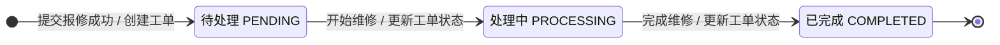
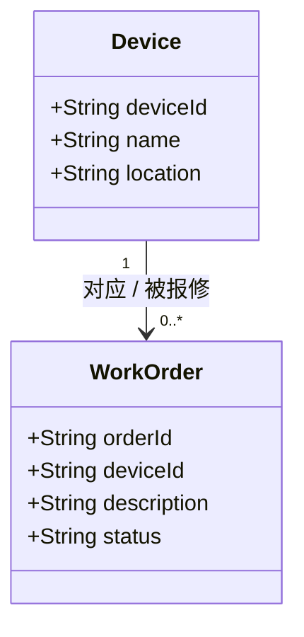

# 状态图与简单类图

本文件由成员B维护，对应任务Issue「任务B 完成状态图与简单类图」，分支 `docs/models-b`。
两张图均使用 Mermaid 编写，代码块本身即为可编辑源材料，GitHub 可直接渲染，也可在 PR 中逐行评审。
图内状态名称与 `docs/requirements.md` 的 FR-01 / FR-02 / FR-03 一致，设备字段取自 `data/devices.csv`。

> 与成员A成果的衔接：`docs/usecase.md` 中三个用例为「查看设备信息(FR-01)」「提交报修(FR-02)」「更新工单状态(FR-03)」，
> 本文件的状态图只细化 FR-03 涉及的工单生命周期，类图提供 FR-01 / FR-02 所需的 Device 与 WorkOrder 结构；
> 报修人、维护人员两个参与者与 `docs/usecase.md` 角色说明一致。

## 一、状态图

### 1.1 图

### 1.2 状态与程序固定英文值对照

| 中文状态 | 程序固定值 | 说明 |
| --- | --- | --- |
| 待处理 | `PENDING` | 工单创建后的初始状态，本次业务的唯一入口状态 |
| 处理中 | `PROCESSING` | 维修人员已开始维修，尚未结束 |
| 已完成 | `COMPLETED` | 维修结束，本次业务的终态 |

英文值区分大小写，代码中不得写成 `pending`、`Processing` 等变体。

### 1.3 事件与转换表

| 编号 | 当前状态 | 事件 | 目标状态 | 是否允许 | 依据 |
| --- | --- | --- | --- | --- | --- |
| S1 | （无，新建） | 提交报修成功 | PENDING | 允许 | FR-02：工单创建即进入待处理 |
| S2 | PENDING | 开始维修 | PROCESSING | 允许 | FR-03 第一条允许规则 |
| S3 | PROCESSING | 完成维修 | COMPLETED | 允许 | FR-03 第二条允许规则 |
| S4 | PENDING | 完成维修 | COMPLETED | 拒绝 | 跳级：必须先进入处理中 |
| S5 | COMPLETED | 开始维修 | PROCESSING | 拒绝 | 回退：已完成是终态 |
| S6 | COMPLETED | 完成维修 | COMPLETED | 拒绝 | 状态不变 |
| S7 | PENDING | 重复开始维修 | PROCESSING | 拒绝 | 状态不变（PENDING→PENDING 属自转换，一律不允许） |
| S8 | 任意 | 重新打开 / 取消 / 跳过处理中 | 任意 | 拒绝 | 本次业务不设这些状态与操作 |

> 说明：表中只列出本次业务约定允许的两条转换 S2、S3。除 S1 的创建动作外，其余所有「当前状态→目标状态」组合（含跳级、回退、状态不变）一律拒绝，与 `src/` 中状态判断函数的返回值一致。

### 1.4 建模约定

1. 初始伪状态 `[*]` 只指向 PENDING，表示工单创建时必然进入待处理，不存在其他初始状态。
2. 只有两个事件可触发状态迁移：「开始维修」与「完成维修」，均由维修人员发起。
3. COMPLETED 为本次业务终态，不设重新打开、撤销、取消等迁出边，也不新增 ON_HOLD、REJECTED 等状态。
4. 报修人不能直接触发状态迁移；报修人只在创建工单时使工单进入 PENDING。

## 二、简单类图

### 2.1 图

### 2.2 类与属性说明

| 类 | 属性 | 类型 | 说明 |
| --- | --- | --- | --- |
| Device 设备 | deviceId | String | 设备编号，唯一标识，如 `DEV-001` |
| Device 设备 | name | String | 设备名称，如「温湿度传感器」 |
| Device 设备 | location | String | 安装位置，如「A101教室」 |
| WorkOrder 工单 | orderId | String | 工单编号，唯一标识 |
| WorkOrder 工单 | deviceId | String | 关联的设备编号，指向 Device.deviceId |
| WorkOrder 工单 | description | String | 故障描述，创建时非空 |
| WorkOrder 工单 | status | String | 工单状态，取值为 PENDING / PROCESSING / COMPLETED |

本实验只分析结构，不要求编写 Device 与 WorkOrder 实体类，因此图中只列属性，不列方法，也不展开实现细节。

> Device 的属性直接取自起始包 `data/devices.csv` 的表头（deviceId、name、location），
> 因此与 FR-01「显示编号、名称、位置」一一对应；WorkOrder 的 status 取值与下文状态图完全一致。

### 2.3 关联与多重性

| 关联 | 多重性 | 含义 |
| --- | --- | --- |
| Device — WorkOrder | `1` : `0..*` | 一台设备可以从未被报修（0张工单），也可以有多张历史工单；每张工单必须且只能对应1台设备 |

说明：

1. 多重性 `0..*` 的 0 端对应「设备登记在清单中但从未报修」的情况，例如 `data/devices.csv` 中尚未产生工单的设备。
2. 每张工单必须有且仅有 1 台设备，因此 WorkOrder 侧的 `deviceId` 不允许为空；提交报修时必须从模拟设备清单中选择设备（见 FR-02）。
3. 工单状态的生命周期画在状态图中，类图只记录 `status` 字段这一数据结构，不把状态图与类图合并为一张图。
4. 设备清单使用起始包中的模拟数据 `data/devices.csv`，本实验不采集真实传感器数据。

## 三、与需求的一致性检查

| 检查项 | 结论 | 核对方式 |
| --- | --- | --- |
| 中文状态与程序英文值对应 | 通过 | 待处理=PENDING、处理中=PROCESSING、已完成=COMPLETED，requirements.md、models.md、源码三处写法完全一致 |
| 只有两条允许转换 | 通过 | 状态图仅有 PENDING→PROCESSING、PROCESSING→COMPLETED 两条迁移边，与 FR-03 一致 |
| 初始状态正确 | 通过 | 初始伪状态只指向 PENDING，与 FR-02「成功时生成工单，初始状态为待处理」一致 |
| 无多余状态 | 通过 | 未增加重新打开、取消、跳过处理中等状态与操作 |
| 事件与角色匹配 | 通过 | 两个事件均由维修人员触发，与 FR-03「角色：维修人员」一致 |
| 设备与工单多重性清楚 | 通过 | `1` : `0..*`，一台设备 0 到多张工单，每张工单 1 台设备 |
| 类属性齐全 | 通过 | Device 含 deviceId、name、location；WorkOrder 含 orderId、deviceId、description、status |
| 与状态判断函数一致 | 通过 | 状态图的两条允许边与 `can_transition` / `canTransition` 中返回 true 的两个分支一一对应，其余组合返回 false |
| 图片引用路径 | 不适用 | 本次使用 Mermaid 代码块作为源材料，未引用外部图片，不存在本机磁盘路径问题 |

- [x] 中文状态与程序英文值对应
- [x] 只允许两条转换
- [x] 一台设备与多张工单关系清楚

## 四、在 PR 中供评审核对的要点

1. 状态图迁移边是否只有两条，标注是否严格为「开始维修」「完成维修」。
2. 初始状态是否为 PENDING，COMPLETED 是否为终态且无迁出边。
3. 类图多重性是否为一个 `1` 对一个 `0..*`，方向是否为「设备→工单」。
4. Device 与 WorkOrder 的属性是否覆盖需求规定的最小集合。
5. 三份材料（requirements.md 的状态规则、models.md 的两张图、源码中的状态判断函数）状态名称是否完全一致。
